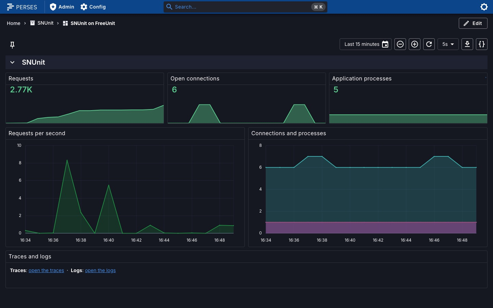
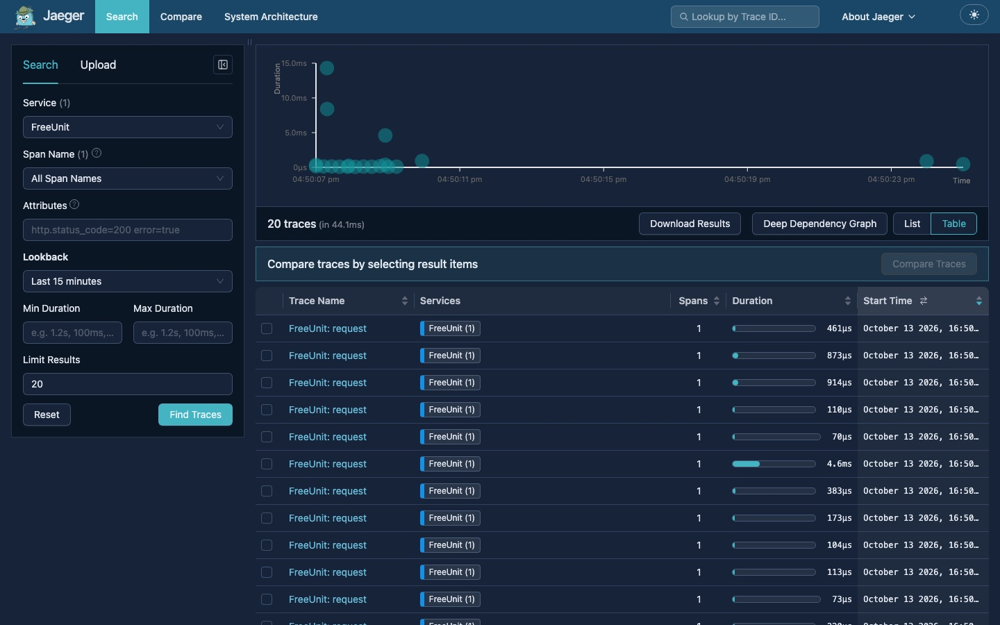
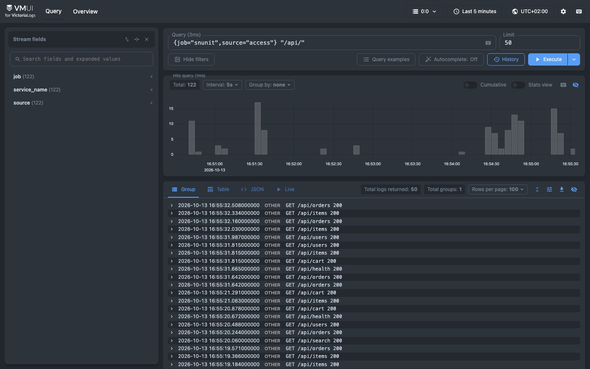
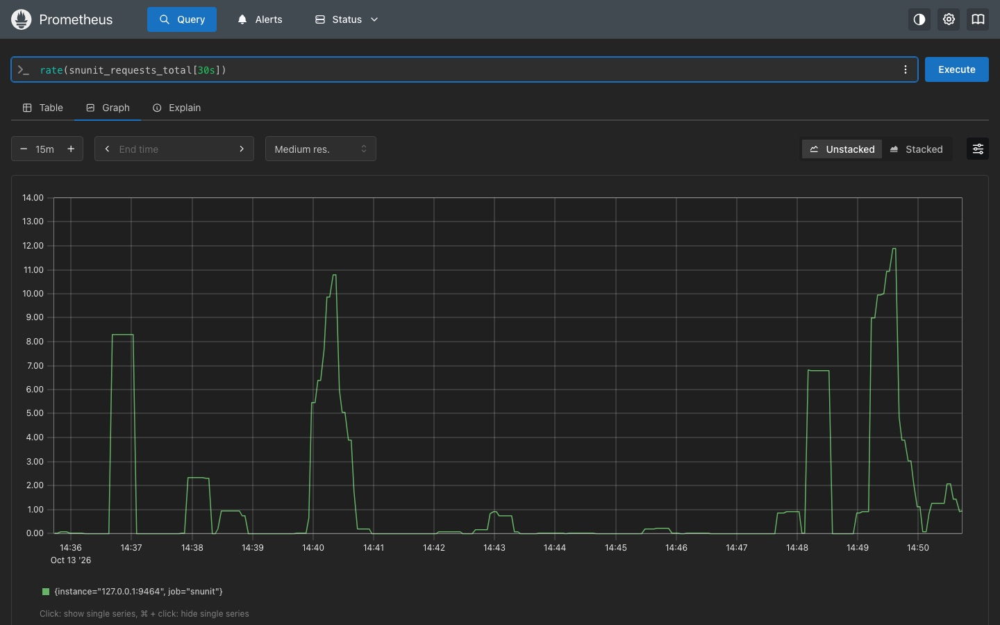

You don't have to set up Prometheus, Jaeger and the others to look at your application. The CLI installs
builds of them that run inside FreeUnit together with the application and are already connected to it:

```bash
snunit stack install              # once: ~/.cache/snunit/stack
snunit run --stack Hello.scala    # run with the stack, no change in the code
```

<div class="shots">
  <figure>
    <a href="img/dashboards.jpg"></a>
    <figcaption><strong>Dashboards</strong>, on localhost:3000. Request rate, open connections and application processes, with links to the traces and the logs.</figcaption>
  </figure>
  <figure>
    <a href="img/traces.jpg"></a>
    <figcaption><strong>Traces</strong>, on localhost:16686. One span for every request FreeUnit handles.</figcaption>
  </figure>
  <figure>
    <a href="img/logs.jpg"></a>
    <figcaption><strong>Logs</strong>, on localhost:9428/select/vmui. The JSON access log, the FreeUnit log and the output of your app.</figcaption>
  </figure>
  <figure>
    <a href="img/metrics.jpg"></a>
    <figcaption><strong>Metrics</strong>, on localhost:9090. The metrics of the launcher, to query with PromQL.</figcaption>
  </figure>
</div>

## What is in it

| Program | Built from | What you see | Address |
|---|---|---|---|
| dashboards | [Perses](https://perses.dev) | request rate, connections, processes | <http://localhost:3000> |
| traces | [Jaeger](https://www.jaegertracing.io) | one span per request | <http://localhost:16686> |
| logs | [VictoriaLogs](https://docs.victoriametrics.com/victorialogs/) | access log, FreeUnit log, output of the programs | <http://localhost:9428/select/vmui> |
| metrics | [Prometheus](https://prometheus.io) | the metrics endpoint of the launcher, scraped | <http://localhost:9090> |

All four are Apache-2.0. Prometheus and Jaeger are CNCF graduated projects and Perses is a CNCF project.
The CNCF has no project that stores logs, so for logs it is VictoriaLogs. They are built by the CI of the
SNUnit repository and downloaded with their checksums.

**These are not the official releases** of those projects: they are built from their sources with a small change (when
started by FreeUnit they serve HTTP through it), and they are not endorsed or supported by their authors. The names
belong to their owners. See [`stack/`](https://github.com/lolgab/snunit/tree/main/stack) and its
[licenses](https://github.com/lolgab/snunit/blob/main/stack/LICENSES.md) (every archive has the licenses
of the program and of its dependencies, and the change we made).

## Limits

- The programs only listen on the loopback interface and have no login. Put your own authentication in front
  before exposing them.
- FreeUnit speaks HTTP/1.1 only, so gRPC doesn't go through it.
- Every program runs with one process.

## From the code

To have the stack in the code instead of the `--stack` flag, and to configure it:

```scala
UnitConfig(
  observability = Some(
    Observability(
      "my-service",
      stack = Some(Stack(dataDirectory = Some("/var/lib/my-service")))
    )
  )
)
```

By default the data is temporary.

## Deploying

Install the stack where the executable runs, for example in your Dockerfile, and tell the executable where it is:

```bash
snunit stack install --dir /opt/snunit-stack
export SNUNIT_STACK_DIR=/opt/snunit-stack
```

## Ports

Your application keeps its own port (8080 by default). The stack uses these:

| Port | Used by | Reachable through FreeUnit | `Stack` field |
|---|---|---|---|
| 3000 | dashboards, web UI | yes | `dashboardsPort` |
| 9090 | metrics, web UI and API | yes | `metricsPort` |
| 16686 | traces, web UI and API | yes | `tracesPort` |
| 9428 | logs, web UI (`/select/vmui`) and API | yes | `logsPort` |
| 4318 | traces, OTLP/HTTP receiver: FreeUnit sends the spans here (`/v1/traces`) | yes, to the same program as the UI | `tracesOtlpPort` |
| any free port | internal ports of dashboards, traces (HTTP, gRPC) and logs behind FreeUnit, on `127.0.0.1` only | no, not meant to be used | `dashboardsInternalPort`, `tracesInternalPort`, `tracesGrpcPort`, `logsInternalPort` (0 = any free port) |

The first five listen on `bindAddress` (`127.0.0.1` by default), the internal ones only on `127.0.0.1`.
They are fields of `Stack`, so they can be changed. On start the application checks that the fixed ones
are free (and says which is not), and prints where the programs are.

## If you already run a stack

Then you don't need this one. Point `Observability.otlpEndpoint` to its OTLP/HTTP receiver,
`Observability.logs` to a Loki-compatible server (`Logs(url = ...)`), and let your Prometheus scrape
`Observability.prometheus`. See [Traces, metrics and logs](observability.html).
